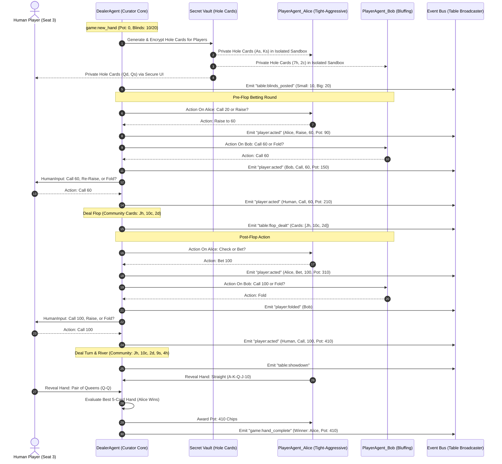
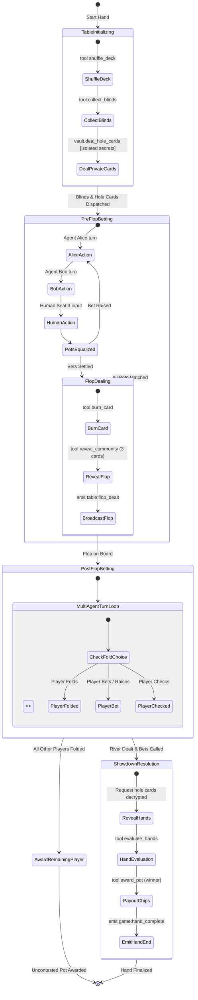
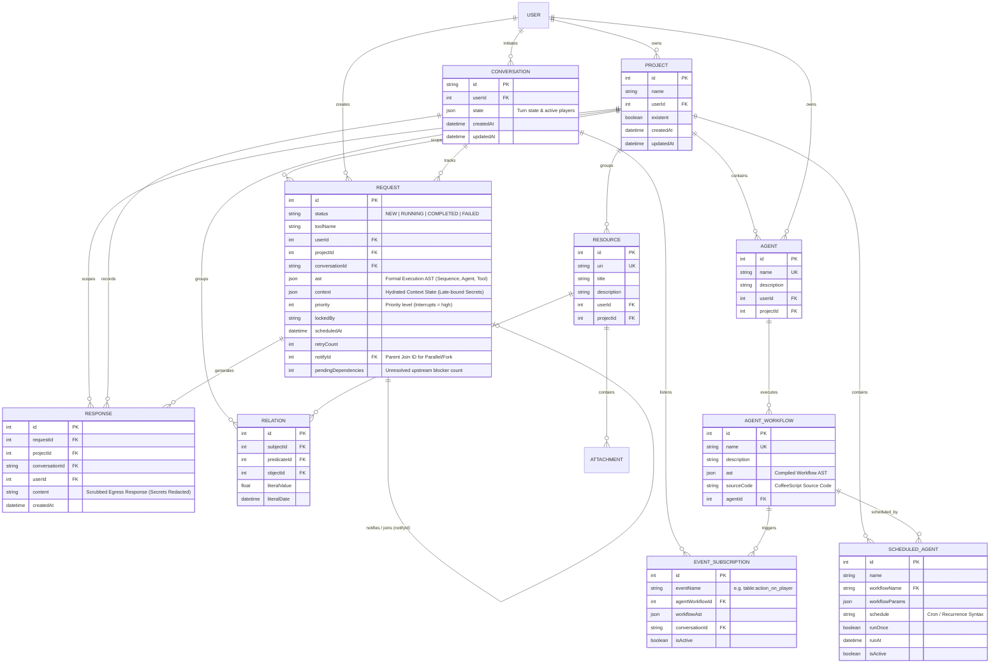
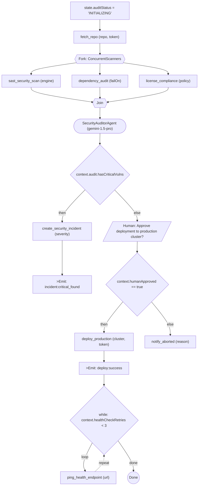

# Curator Multi-Modal Workflow & Architecture Preview
> **Barebones Mermaid Diagrams, CoffeeScript DSL, and Execution AST**

---

## 1. Multi-Agent Interaction Sequence Shape (Mermaid Sequence Diagram)
> *Demonstrating multi-agent coordination, turn-taking, safe secret isolation, and event broadcasting in a Texas Hold'em Poker Game in Curator.*



---

## 2. AST State Machine Shape (Mermaid State Diagram)
> *State transitions and execution lifecycle for the multi-turn poker table AST workflow.*



---

## 3. Curator Prisma Database Schema (Mermaid ERD)
> *Core database entities and relationships backing Curator agent requests, execution ASTs, context state, and project scoping.*



---

## 4. Pipeline Topology Shape (Mermaid Flowchart)
> *Topology of concurrent scanners, automated reasoning agent, and conditional release gate.*



---

## 5. Declarative Code Shape (CoffeeScript DSL)
> *Exemplifying late-binding secret verbs, multi-agent turns, human-in-the-loop gates, and event emitters.*

```coffeescript
seq "EnterpriseSecurityPipeline",
  assign "state.auditStatus", "'INITIALIZING'"

  tool "fetch_repo",
    repo: "joelarula/curator"
    token: secret "GITHUB_TOKEN"

  parallel "ConcurrentScanners",
    tool("sast_security_scan", engine: "semgrep"),
    tool("dependency_audit", failOn: "high"),
    tool("license_compliance", policy: "apache_or_mit")

  agent
    agentName: "SecurityAuditorAgent"
    model: "gemini-1.5-pro"
    prompt: "Synthesize scanner findings and assign threat level"

  if_else "context.audit.hasCriticalVulns",
    seq "IncidentHandling",
      tool("create_security_incident", severity: "P1"),
      emit_event("incident:critical_found", incidentId: "SEC-101")

    seq "ReleaseGate",
      humanInput("Approve deployment to production cluster?", "choices", ["approve", "reject"]),
      if_else "context.humanApproved == true",
        seq "ProductionRollout",
          tool("deploy_production", cluster: "us-east-prod", token: secret "KUBE_TOKEN"),
          emit_event("deploy:success"),
          while_loop "context.healthCheckRetries < 3",
            tool("ping_health_endpoint", url: "https://api.curator.arula.dev/healthz")
        tool("notify_aborted", reason: "User rejected release")
```

---

## 6. Formal Execution AST JSON
> *The exact AST persisted in the `Request.ast` column and executed recursively by `CuratorRequestProcessor`.*

```json
{
  "type": "Curator_Sequential",
  "name": "EnterpriseSecurityPipeline",
  "subAgents": [
    {
      "type": "Curator_Assign",
      "key": "state.auditStatus",
      "expression": "'INITIALIZING'"
    },
    {
      "type": "Curator_Tool",
      "toolName": "fetch_repo",
      "args": {
        "repo": "joelarula/curator",
        "token": "$secret:GITHUB_TOKEN"
      }
    },
    {
      "type": "Curator_Parallel",
      "name": "ConcurrentScanners",
      "subAgents": [
        { "type": "Curator_Tool", "toolName": "sast_security_scan", "args": { "engine": "semgrep" } },
        { "type": "Curator_Tool", "toolName": "dependency_audit", "args": { "failOn": "high" } },
        { "type": "Curator_Tool", "toolName": "license_compliance", "args": { "policy": "apache_or_mit" } }
      ]
    },
    {
      "type": "Curator_Agent",
      "agentName": "SecurityAuditorAgent",
      "model": "gemini-1.5-pro",
      "prompt": "Synthesize scanner findings and assign threat level"
    },
    {
      "type": "Curator_IfElse",
      "condition": "context.audit.hasCriticalVulns",
      "thenBranch": {
        "type": "Curator_Sequential",
        "name": "IncidentHandling",
        "subAgents": [
          { "type": "Curator_Tool", "toolName": "create_security_incident", "args": { "severity": "P1" } },
          { "type": "Curator_EmitEvent", "eventName": "incident:critical_found", "payload": { "incidentId": "SEC-101" } }
        ]
      },
      "elseBranch": {
        "type": "Curator_Sequential",
        "name": "ReleaseGate",
        "subAgents": [
          {
            "type": "Curator_HumanInput",
            "prompt": "Approve deployment to production cluster?",
            "inputType": "choices",
            "choices": ["approve", "reject"]
          },
          {
            "type": "Curator_IfElse",
            "condition": "context.humanApproved == true",
            "thenBranch": {
              "type": "Curator_Sequential",
              "name": "ProductionRollout",
              "subAgents": [
                {
                  "type": "Curator_Tool",
                  "toolName": "deploy_production",
                  "args": { "cluster": "us-east-prod", "token": "$secret:KUBE_TOKEN" }
                },
                { "type": "Curator_EmitEvent", "eventName": "deploy:success" },
                {
                  "type": "Curator_While",
                  "condition": "context.healthCheckRetries < 3",
                  "body": {
                    "type": "Curator_Tool",
                    "toolName": "ping_health_endpoint",
                    "args": { "url": "https://api.curator.arula.dev/healthz" }
                  }
                }
              ]
            },
            "elseBranch": {
              "type": "Curator_Tool",
              "toolName": "notify_aborted",
              "args": { "reason": "User rejected release" }
            }
          }
        ]
      }
    }
  ]
}
```
