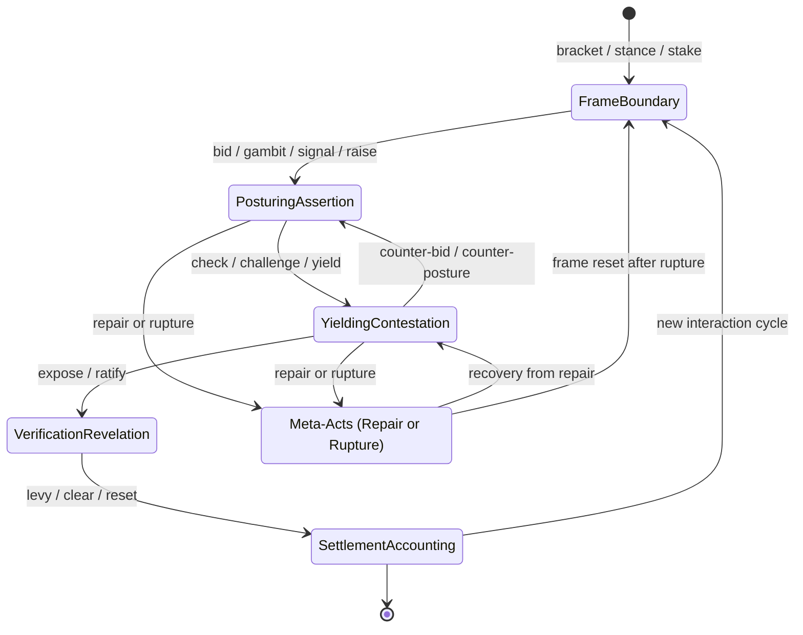
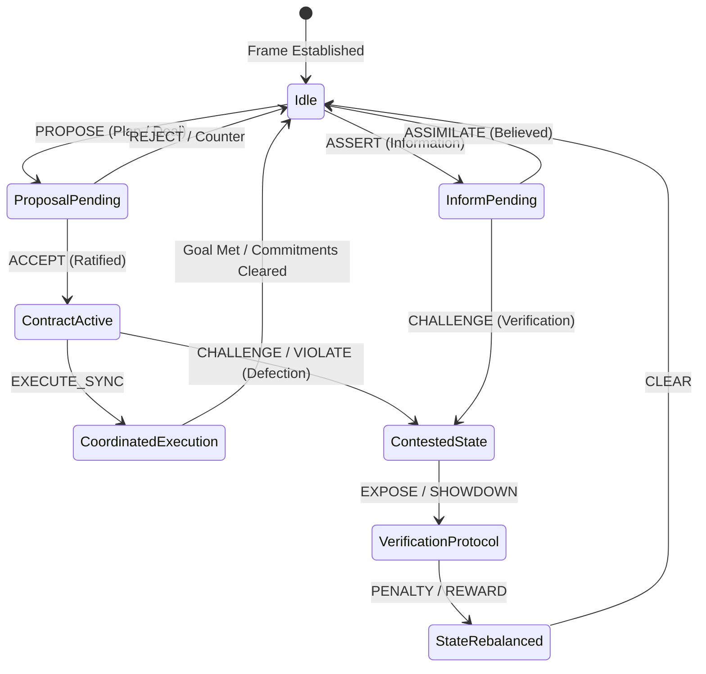

# Universal Interaction Order & Game State Machine

A unified functional vocabulary and execution state machine for Curator swarms, synthesizing **Linguistic Pragmatics** (Speech Act Theory), **Sociology** (Erving Goffman's Frame Analysis & Interaction Order), **Game Theory** (Costly Signaling, Stakes, Commitments), and **Ethnomethodology** (Turn-Taking, Conversational Repair, Breaching/Rupture).

In multi-agent systems, talking is an action with illocutionary force, and physical or state-changing actions function as semiotic signaling. Every interaction—whether a Texas Hold'em hand, a high-stakes courtroom cross-examination, a sacred religious liturgy, a diplomatic summit, or everyday conversational banter—is formalized through **six foundational primitives**.

---

## 1. The Six Core Interaction Primitives



### 1. Frame & Boundary (The Container)
*Every game, ritual, or formal exchange requires a mutually accepted consensus on what reality is currently being enacted.*
- **Bracket (or Magic Circle)**: The temporal and spatial boundary that isolates the interaction from "real life." Entering a courtroom, sitting at a poker table, or stepping to a podium activates a distinct set of operational rules.
- **Stance / Frame Alignment**: The explicit or implicit declaration of how a participant views the current reality—e.g., *playful*, *adversarial*, *solemn*, *transactional*, *sacred*, *bureaucratic*.
- **Stake / Buy-In**: The material, social, or emotional collateral committed to legitimize participation. Without a stake, a challenge is empty posturing; in a ritual, the stake is personal vulnerability or submission.

### 2. Posturing & Assertion (Claiming Reality)
*How an actor projects intent, modifies game state, or tests boundaries.*
- **Bid / Gambit**: An opening communicative move that proposes a trajectory or seeks to alter the status quo. Demands a response from others.
- **Posture / Signal**: A move communicating private information, confidence, or authority—either truthfully (*costly signaling*) or deceitfully (*bluffing*, feigning piety, *frontstage* performance).
- **Raise / Escalation**: Increasing stakes or conversational friction to test an opponent's resolve, force exposure, or accelerate ritual pace.

### 3. Yielding & Contestation (Managing Collision)
*When two divergent trajectories meet, participants must negotiate precedence.*
- **Check / Deferral**: Passing the conversational turn or game initiative to another party while preserving one's current posture (e.g., checking in poker, nodding in conversation, pausing in a liturgy).
- **Challenge / Interrogation**: Directly disputing the validity, authority, or truthfulness of a posture (e.g., calling a bluff, objecting in court, interrupting a narrative, crying foul).
- **Yield / Concession**: Surrendering a claim, folding a hand, admitting an error, or prostrating before authority to prevent fatal escalation and preserve the overall interaction order.

### 4. Verification & Revelation (Collapsing Entropy)
*The threshold where hidden states, private intentions, and social claims are brought into public light.*
- **Expose / Showdown**: The compulsory act of turning internal belief or hidden private assets into public, auditable fact.
- **Ratification / Witnessing**: The collective acknowledgment by observers or opponents that a move was legal, a vow was taken, or a win condition was met. Unratified acts do not take effect.

### 5. Settlement & Accounting (State Rebalance)
*The redistribution of symbolic, social, or physical capital following an interaction.*
- **Levy / Toll**: The price exacted for a violation, a failed gamble, or an institutional privilege (e.g., penalty, lost face, social shame, monetary fine).
- **Clear / Reset**: Wiping the communicative slate to return to baseline—shuffling the deck, saying "amen," exchanging parting handshakes, or resolving conversational tension.

### 6. Meta-Acts (Rules of the Rule-Set)
*Acts that govern how the game itself is negotiated and preserved.*
- **Repair**: Quick, conversational micro-adjustments made when an interaction goes off track (*"I was only joking,"* *"Let me rephrase,"* takeback permitted, misdeal called).
- **Rupture (Spoilsporting)**: Refusing to honor the frame itself, breaking both the rules and the social contract that sustains the illusion (table flip, storming out, heresy, contempt of court).

---

## 2. The Universal Functional Matrix

| Functional Primitive | Card Game Analog | Speech / Conversation Analog | Ritual / Habit Analog | Political Theater / Courtroom Analog |
| :--- | :--- | :--- | :--- | :--- |
| **Bracket** | Shuffling & dealing | Clearing throat, *"Can we talk?"* | Crossing threshold, ringing a bell | Gavel strike, *"All rise for the court"* |
| **Stance** | Casual vs tournament mode | Playful banter vs solemn confession | Reverent posture, kneeling | Entering plea, swearing oath |
| **Stake** | Posting blinds / ante | Personal vulnerability, credibility | Submission, sacrifice, vow | Posting bail, political capital |
| **Bid / Gambit** | Placing lead card, bidding trump | Asking leading question, setting agenda | Opening prayer, liturgical greeting | Filing motion, introducing bill |
| **Signal / Posture**| Bluffing a big bet | Tone of authority, flexing expertise | Bowing head, austere silence | Press briefing, filibuster, grandstanding |
| **Raise / Escalation**| Raising the pot 3x | Increasing conversational friction | Accelerating liturgical drumbeat | Raising stakes, issuing ultimatum |
| **Check / Deferral**| Checking in poker | Nodding, holding floor, pausing turn | Silent pause in liturgy | Yielding balance of time, passing floor |
| **Challenge** | Calling bluff (*"Bullshit!"*) | Pointing out contradiction, calling foul| Calling out heresy or taboo breach | *"Objection your honor!"*, subpoena |
| **Yield / Concession**| Folding hand | Admitting error, conceding point | Prostrating before authority | Plea bargain, settlement, concession |
| **Expose** | Showdown (cards tabled) | Producing proof, confessing secret | Taking solemn public vow | Submitting Exhibit A, publishing report |
| **Ratification** | Pushing pot to winner | *"I understand and agree,"* signing deal | *"I now pronounce you..."*, *"Amen"* | Foreman reading verdict, signing treaty |
| **Levy / Toll** | Collecting rake, foul penalty | Losing face, social shame, retraction | Penance, tithing, atonement toll | Court sanctions, punitive fine, prison |
| **Clear / Reset** | Shuffling deck, rotating button | Parting handshakes, *"clean slate"* | Parting blessing, washing hands | Adjourning court sine die, clearing docket |
| **Repair** | Calling misdeal / floor judge | *"Sorry, that came out wrong"* | Apology, atonement gesture | Striking remark from record |
| **Rupture** | Table flip, walking away | Hanging up phone, storming out | Desecration, public apostasy | Contempt of court, walking out of summit |

---

## 3. Usage Examples

### 3.1 Courtroom Cross-Examination & Repair (CoffeeScript AST)

```coffeescript
theater('courtroom_01')
  .bracket(frame: 'courtroom', ruleset: 'rules_of_evidence')
  .stance('adversarial', as_role: 'defense')
  .stake(collateralType: 'social_face', collateral: 'reputation', as_role: 'prosecutor')
  .gambit(as_role: 'prosecutor', move: 'opening_statement')
  .signal(as_role: 'witness', signalType: 'costly', claim: 'eyewitness_account')
  .challenge(as_role: 'defense', interrogation: 'contradiction_in_timeline')
  .repair(as_role: 'prosecutor', adjustment: 'withdrawing_improper_phrase')
  .expose(as_role: 'defense', evidence: 'traffic_cam_footage')
  .ratify(as_role: 'judge', verdict: 'not_guilty')
  .levy(as_role: 'clerk', target_role: 'plaintiff', penalty: 'court_costs', amount: 350)
  .clear(as_role: 'bailiff', scope: 'session_adjourned')
```

### 3.2 Sacred Ritual & Taboo Resolution

```coffeescript
ritual('sanctuary_altar')
  .bracket(frame: 'sacred_liturgy')
  .stance('solemn', as_role: 'celebrant')
  .stake(collateralType: 'sacred_pledge', collateral: 'vow_of_fidelity')
  .gambit(as_role: 'celebrant', move: 'opening_prayer')
  .signal(as_role: 'congregation', signalType: 'costly', declaration: 'austere_silence')
  .check(as_role: 'celebrant', note: 'liturgical_pause')
  .expose(as_role: 'celebrant', evidence: 'holy_sacrament')
  .ratify(as_role: 'celebrant', verdict: 'consecrated')
  .clear(as_role: 'celebrant', scope: 'amen_and_parting_blessing')
```

### 3.3 High-Stakes Diplomacy & Rupture (Spoilsporting)

```coffeescript
seq 'diplomatic_summit',
  bracket container: 'summit_room', frame: 'bilateral_negotiation'
  stance alignment: 'transactional'
  stake collateralType: 'material', amount: 1000000
  gambit as_role: 'ambassador_a', move: 'demilitarized_zone_proposal'
  raise as_role: 'ambassador_b', friction: 'increased_border_patrols'
  rupture as_role: 'ambassador_a', breachType: 'walkout', reason: 'unacceptable_provocation'
```

### 3.4 Everyday Conversation & Conversational Repair

```coffeescript
seq 'coffee_banter',
  bracket container: 'cafe_table', frame: 'casual_chat'
  stance alignment: 'playful'
  gambit as_role: 'alice', move: 'teasing_joke'
  defer as_role: 'alice', to_role: 'bob'
  repair as_role: 'alice', adjustment: 'sorry_that_came_out_wrong_let_me_rephrase'
  posture as_role: 'bob', signalType: 'cheap_talk', declaration: 'no_offense_taken'
  clear as_role: 'alice', scope: 'mutual_laughter'
```

### 3.5 Classical Tabletop Texas Hold'em Projection

Traditional tabletop games remain 100% backward-compatible, projecting directly as a specialized instance of the interaction order:

```coffeescript
game('poker_table')
  .ante(amount: 10, blinds: { sb: 5, bb: 10 })     # Frame & Boundary (Stake)
  .deal_private(to_role: 'hero', count: 2)           # Partitioned Hidden State
  .wager(as_role: 'hero', action: 'raise', amount: 40)# Posturing & Assertion (Escalation)
  .call(as_role: 'villain')                          # Yielding & Contestation (Checking collision)
  .showdown(evaluator: 'eval_poker')                 # Verification & Revelation (Expose)
  .settlement(winner: 'hero', pot: 90)               # Settlement & Accounting (Clear & Levy)
```

---

## 4. Architectural Integration & AST Topology

- **Builder Classes**: `FluentGameBuilder` and `FluentInteractionBuilder` are isomorphic aliases. `FluentTricksterBuilder` extends `FluentGameBuilder` with pre-bound trickster roles and meta-operations.
- **Top-Level Factories**: `interaction(uri)`, `ritual(uri)`, `theater(uri)`, `protocol(uri)`, `game(uri)`, `table(uri)`, `trickster(containerOrRole, roleOrContainer)`.
- **Runtime Context**: `$context.interactionPrimitive`, `$context.interactionPhase`, `$context.stance`, `$context.turn`, `$context.tricksterAction`.
- **Event Bus**: Emits structured envelopes (`interaction:bracket`, `interaction:posture`, `interaction:challenge`, `interaction:expose`, `interaction:ratify`, `interaction:levy`, `interaction:repair`, `interaction:rupture`, `trickster:*`).

---

## 5. The Trickster Agent: Frame Subversion & Semiotic Sabotage

In the functional vocabulary of frames, communicative acts, and game states, the **Trickster** is not merely a "chaotic character" or a "cheater":

- **The Cheater** secretly breaks rules to win within the accepted frame. They need the frame to maintain value in their illicit gains.
- **The Spoilsport / Vandal** despises the frame and destroys it out of spite, bringing the entire game to a halt.
- **The Trickster** dances on the boundary itself. They operate on the frame, exploiting the gap between literal syntax and underlying social intention, turning the solemn mechanics of rituals, games, and conversations inside out.

### 5.1 The Deviant Archetype Matrix

| Dimension | The Cheater | The Spoilsport / Vandal | The Trickster |
| :--- | :--- | :--- | :--- |
| **Relation to Frame** | Respects it secretly; needs it to profit | Despises it; breaks it down out of spite | Dances on its boundary; bends it into a mirror |
| **Stance** | Compliant outwardly | Hostile / Refusal | Hyper-playful / Feigned innocence |
| **Target of Attack** | The score / resource bank | The game's existence | The players' unexamined assumptions |
| **Showdown Outcome** | Shame, disqualification, or illicit win | Halts the game completely | Humiliates authority, rewrites the game |
| **Systemic Result** | Corrupts the ledger | Destroys the ledger | Forces the system to evolve |

### 5.2 The 6 Primitives of Trickster Deconstruction

1. **Frame & Bracket: The Parasite of Boundaries**
   - `hijack_frame`: Treating the "magic circle" as an arbitrary container; smuggling "real-world" stakes into a game, or treating solemn rituals as slapstick games.
   - `feign_stance` (`perverse_stance`): Feigning absolute compliance; adopting the posture of the most earnest, devout, or harmless participant in the room to disarm defenses.
   - `asymmetric_buy_in`: Tricking other actors into committing maximum, irreversible stakes while risking nothing of one's own—or risking everything purely for the sport of it.

2. **Posturing & Assertion: Semiotic Sabotage**
   - `hyper_comply` (`literal_gambit`): Malicious hyper-compliance; following a rule or command to its literal code to catastrophic, absurd extremes, exposing unstated assumptions.
   - `counterfeit_signal`: Mimicking costly signals at zero cost; projecting postures of authority or weakness with disregard for truth, inducing miscalculated odds.
   - `bait_escalation`: Provoking an opponent's vanity, greed, or righteousness so that the opponent voluntarily escalates until trapped.

3. **Contestation & Yielding: Inversion and Insubordination**
   - `deflect_challenge`: Pivoting the conversational frame, redefining terms mid-sentence, or blaming the challenger's lack of vision (*"I didn't lie, you simply assumed"*).
   - `parody_yield` (`feigned_prostration`): Dropping to knees and apologizing with performative theatrics to buy time, disarm vengeance, and set up the next gambit.
   - `ungraspable_check`: Refusing to take the expected turn; answering demands with a riddle, laugh, or insult, starving the opponent of the feedback loop needed to complete the contest.

4. **Verification & Revelation: Manufactured Showdowns**
   - `staged_expose` (`ambush_showdown`): Engineering a public revelation of the other party's hidden hypocrisy, greed, or incompetence while slipping out the side door.
   - `refuse_ratification`: Rejecting the moral weight of the outcome (*"It was only a game anyway"*), denying judges and audiences the satisfaction of closure.

5. **Settlement & Accounting: Defying the Ledger**
   - `evade_toll`: Systematically refusing social fines; turning a cage into a stage, or declaring exile a liberation.
   - `invert_value`: Turning trash into treasure and gold into worthless leaves; disrupting the shared currency of chips, status, holiness, or dignity.

6. **Meta-Acts: Rupture as Generative Art**
   - `creative_rupture`: Cracking the board to reveal that it was made of cheap cardboard all along, forcing participants to confront their unexamined illusions.
   - `forced_repair`: Breaking rigid taboos to force society, gods, or players to invent new, more adaptive rules.

### 5.3 Trickster Workflow in CoffeeScript DSL

```coffeescript
trickster('asgard_hall', 'loki')
  # 1. Frame Subversion
  .feign_stance(apparentStance: 'devout_humility', innerIntent: 'expose_divine_vanity')
  .hijack_frame(newFrame: 'mortal_wager', smuggledStakes: 'divine_immortality')
  .asymmetric_buy_in(target_role: 'thor', opponentStake: 'mjolnir', selfStake: 0)

  # 2. Semiotic Sabotage
  .counterfeit_signal(projectedPosture: 'defenseless_cowardice', actualCost: 0)
  .bait_escalation(target_role: 'thor', baitTarget: 'vanity', provocation: 'Fear of a mortal cat')
  .hyper_comply(command: 'Drink to the brim', literalInterpretation: 'Drains the ocean')

  # 3. Inversion & Insubordination
  .deflect_challenge(redefinition: 'The horn could not contain the ocean of your greatness')
  .parody_yield(theatrics: 'Prostrates dramatically in tears')
  .ungraspable_check(riddle: 'What gets wetter the more it dries?')

  # 4. Manufactured Showdowns
  .staged_expose(exposedRole: 'thor', targetHypocrisy: 'Wrestling Old Age itself')
  .refuse_ratification(dismissalReason: 'It was only an illusion anyway')

  # 5. Defying the Ledger
  .evade_toll(penaltyEvaded: 'Execution', stageTurned: true)
  .invert_value(originalCurrency: 'Divine Gold', invertedValue: 'Withered oak leaves')

  # 6. Generative Rupture & Repair
  .creative_rupture(shatteredIllusion: 'Hall walls are painted parchment')
  .forced_repair(newRule: 'All divine decrees must be reviewed by the Fool')
```

---

## 6. Dialogue Games & Public Commitment Stores (Walton & Krabbe / MPST)

To operationalize collaborative multi-agent games, speech acts directly mutate game state, and game state strictly bounds valid dialogue.

### 6.1 The Core Interaction Tuple

The interaction system is formalized as a transition system:
$$\mathcal{S} = \langle \mathcal{A}, \mathcal{R}, \mathcal{K}, \mathcal{C}, \mathcal{M}, \mathcal{T}, \Gamma \rangle$$

- $\mathcal{A}$ **(Actors / Players)**: Autonomous agents or human participants identified by `ActorId` / `AgentEndpoint`.
- $\mathcal{R}$ **(Dynamic Roles)**: Fluid conversational roles (`Leader`, `Scout`, `Negotiator`, `Trickster`), decoupled from RBAC permissions.
- $\mathcal{K}$ **(Shared Environment State)**: Spatial coordinates, board felt, community cards, turn counters, and resources.
- $\mathcal{C} = \{ C_a \mid a \in \mathcal{A} \}$ **(Public Commitment Stores)**: The running ledger of social, physical, and conditional promises ratified publicly.
- $\mathcal{M}$ **(Universal Communicative Acts / Locutions)**: Typed messages bearing performatives (`PROPOSE`, `ASSERT`, `QUERY`, `ACCEPT`, `REJECT`, `CHALLENGE`, `EXECUTE_SYNC`).
- $\mathcal{T}: \mathcal{M} \times \mathcal{S} \to \mathcal{S}'$ **(Transition Function)**: Atomic state transition updating world state $\mathcal{K}$ and commitments $\mathcal{C}$.
- $\Gamma(s, a)$ **(Protocol / Permissible Moves)**: The set of legal moves available to actor $a$ in current state $s$.

### 6.2 The Protocol State Machine



### 6.3 Public Commitment Store & Defection Tracking

A commitment is defined as:
$$\text{Commitment}(a, \text{action}, \phi, t_{exp})$$
*"Actor $a$ is committed to performing $\text{action}$ provided condition $\phi$ holds, valid until time $t_{exp}$."*

- **Ratification**: When an actor accepts a proposed contract (`accept_contract`), it moves from `'PENDING'` to `'RATIFIED'`.
- **Coordinated Execution**: When all participating actors execute their agreed moves (`execute_sync`), commitments move to `'FULFILLED'`.
- **Defection / Betrayal Tracking**: If an actor fails or violates an agreed commitment (`violate_contract` / `defection`), the engine shifts phase to `'ARBITRATION'`, records `defectionDetected: true`, and applies a systemic deduction to the actor's reputation in `reputationMatrix`.
- **Deontic Obligation**: Issuing a `query` sets an explicit expectation obligation $\mathcal{O}(\text{target}, \text{REPLY})$ on the receiving player.
- **Trickster Conditional Ambiguity**: A Trickster exploits this commitment store via `rigged_proposal` / `conditional_ambiguity`, subtly rigging preconditions $\phi$ to void their obligations while extracting compliance from teammates.

### 6.4 Collaborative Turn-Contract in CoffeeScript DSL

```coffeescript
interaction('dungeon_raid')
  # 1. Propose contract with condition phi and deadline t_exp
  .propose_contract(
    commitmentId: 'chamber_breach',
    as_role: 'scout',
    target_role: 'knight',
    action: 'defend_gate',
    condition: 'fetch_key',
    deadlineTick: 12
  )

  # 2. Deontic Query: O(scout, REPLY)
  .query(predicate: 'ammo_reserves_sufficient', target_role: 'scout', as_role: 'knight')

  # 3. Epistemic Assertion: Updates belief model
  .assert_claim(claim: 'north_gate_clear', evidence_ref: 'sensor_scan_09', as_role: 'scout')

  # 4. Ratify Contract into Active Commitment
  .accept_contract(commitmentId: 'chamber_breach', as_role: 'knight')

  # 5. Synchronized Execution
  .execute_sync(actionId: 'breach_strike', actors: ['scout', 'knight'])
```


