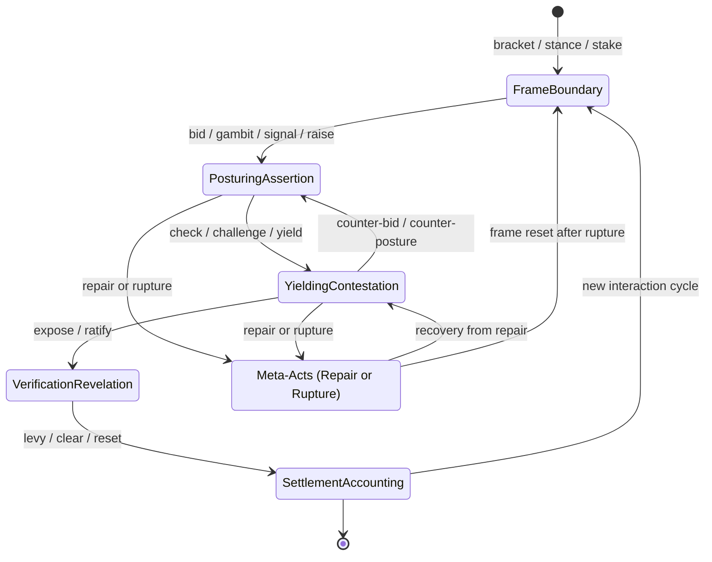

# Universal Interaction Order & Game State Machine

A unified functional vocabulary and execution state machine for Curator swarms, synthesizing **Linguistic Pragmatics** (Speech Act Theory), **Sociology** (Erving Goffman's Frame Analysis & Interaction Order), **Game Theory** (Costly Signaling, Stakes, Commitments), and **Ethnomethodology** (Turn-Taking, Conversational Repair, Breaching/Rupture).

In multi-agent systems, talking is an action with illocutionary force, and physical or state-changing actions function as semiotic signaling. Every interaction—whether a Texas Hold'em hand, a high-stakes courtroom cross-examination, a sacred religious liturgy, a diplomatic summit, or everyday conversational banter—is formalized through **six foundational primitives**.

---

## 1. The Six Core Interaction Primitives



### 1. Frame & Boundary (The Container)
*Every game, ritual, or formal exchange requires a mutually accepted consensus on what reality is currently being enacted.*
- **Bracket (or Magic Circle)**: The temporal and spatial boundary that isolates the interaction from "real life." Entering a courtroom, sitting at a poker table, or stepping to a podium activates a distinct set of operational rules.
- **Stance / Frame Alignment**: The explicit or implicit declaration of how a participant views the current reality—e.g., *playful*, *adversarial*, *solemn*, *transactional*, *sacred*, *bureaucratic*.
- **Stake / Buy-In**: The material, social, or emotional collateral committed to legitimize participation. Without a stake, a challenge is empty posturing; in a ritual, the stake is personal vulnerability or submission.

### 2. Posturing & Assertion (Claiming Reality)
*How an actor projects intent, modifies game state, or tests boundaries.*
- **Bid / Gambit**: An opening communicative move that proposes a trajectory or seeks to alter the status quo. Demands a response from others.
- **Posture / Signal**: A move communicating private information, confidence, or authority—either truthfully (*costly signaling*) or deceitfully (*bluffing*, feigning piety, *frontstage* performance).
- **Raise / Escalation**: Increasing stakes or conversational friction to test an opponent's resolve, force exposure, or accelerate ritual pace.

### 3. Yielding & Contestation (Managing Collision)
*When two divergent trajectories meet, participants must negotiate precedence.*
- **Check / Deferral**: Passing the conversational turn or game initiative to another party while preserving one's current posture (e.g., checking in poker, nodding in conversation, pausing in a liturgy).
- **Challenge / Interrogation**: Directly disputing the validity, authority, or truthfulness of a posture (e.g., calling a bluff, objecting in court, interrupting a narrative, crying foul).
- **Yield / Concession**: Surrendering a claim, folding a hand, admitting an error, or prostrating before authority to prevent fatal escalation and preserve the overall interaction order.

### 4. Verification & Revelation (Collapsing Entropy)
*The threshold where hidden states, private intentions, and social claims are brought into public light.*
- **Expose / Showdown**: The compulsory act of turning internal belief or hidden private assets into public, auditable fact.
- **Ratification / Witnessing**: The collective acknowledgment by observers or opponents that a move was legal, a vow was taken, or a win condition was met. Unratified acts do not take effect.

### 5. Settlement & Accounting (State Rebalance)
*The redistribution of symbolic, social, or physical capital following an interaction.*
- **Levy / Toll**: The price exacted for a violation, a failed gamble, or an institutional privilege (e.g., penalty, lost face, social shame, monetary fine).
- **Clear / Reset**: Wiping the communicative slate to return to baseline—shuffling the deck, saying "amen," exchanging parting handshakes, or resolving conversational tension.

### 6. Meta-Acts (Rules of the Rule-Set)
*Acts that govern how the game itself is negotiated and preserved.*
- **Repair**: Quick, conversational micro-adjustments made when an interaction goes off track (*"I was only joking,"* *"Let me rephrase,"* takeback permitted, misdeal called).
- **Rupture (Spoilsporting)**: Refusing to honor the frame itself, breaking both the rules and the social contract that sustains the illusion (table flip, storming out, heresy, contempt of court).

---

## 2. The Universal Functional Matrix

| Functional Primitive | Card Game Analog | Speech / Conversation Analog | Ritual / Habit Analog | Political Theater / Courtroom Analog |
| :--- | :--- | :--- | :--- | :--- |
| **Bracket** | Shuffling & dealing | Clearing throat, *"Can we talk?"* | Crossing threshold, ringing a bell | Gavel strike, *"All rise for the court"* |
| **Stance** | Casual vs tournament mode | Playful banter vs solemn confession | Reverent posture, kneeling | Entering plea, swearing oath |
| **Stake** | Posting blinds / ante | Personal vulnerability, credibility | Submission, sacrifice, vow | Posting bail, political capital |
| **Bid / Gambit** | Placing lead card, bidding trump | Asking leading question, setting agenda | Opening prayer, liturgical greeting | Filing motion, introducing bill |
| **Signal / Posture**| Bluffing a big bet | Tone of authority, flexing expertise | Bowing head, austere silence | Press briefing, filibuster, grandstanding |
| **Raise / Escalation**| Raising the pot 3x | Increasing conversational friction | Accelerating liturgical drumbeat | Raising stakes, issuing ultimatum |
| **Check / Deferral**| Checking in poker | Nodding, holding floor, pausing turn | Silent pause in liturgy | Yielding balance of time, passing floor |
| **Challenge** | Calling bluff (*"Bullshit!"*) | Pointing out contradiction, calling foul| Calling out heresy or taboo breach | *"Objection your honor!"*, subpoena |
| **Yield / Concession**| Folding hand | Admitting error, conceding point | Prostrating before authority | Plea bargain, settlement, concession |
| **Expose** | Showdown (cards tabled) | Producing proof, confessing secret | Taking solemn public vow | Submitting Exhibit A, publishing report |
| **Ratification** | Pushing pot to winner | *"I understand and agree,"* signing deal | *"I now pronounce you..."*, *"Amen"* | Foreman reading verdict, signing treaty |
| **Levy / Toll** | Collecting rake, foul penalty | Losing face, social shame, retraction | Penance, tithing, atonement toll | Court sanctions, punitive fine, prison |
| **Clear / Reset** | Shuffling deck, rotating button | Parting handshakes, *"clean slate"* | Parting blessing, washing hands | Adjourning court sine die, clearing docket |
| **Repair** | Calling misdeal / floor judge | *"Sorry, that came out wrong"* | Apology, atonement gesture | Striking remark from record |
| **Rupture** | Table flip, walking away | Hanging up phone, storming out | Desecration, public apostasy | Contempt of court, walking out of summit |

---

## 3. Usage Examples

### 3.1 Courtroom Cross-Examination & Repair (CoffeeScript AST)

```coffeescript
theater('courtroom_01')
  .bracket(frame: 'courtroom', ruleset: 'rules_of_evidence')
  .stance('adversarial', as_role: 'defense')
  .stake(collateralType: 'social_face', collateral: 'reputation', as_role: 'prosecutor')
  .gambit(as_role: 'prosecutor', move: 'opening_statement')
  .signal(as_role: 'witness', signalType: 'costly', claim: 'eyewitness_account')
  .challenge(as_role: 'defense', interrogation: 'contradiction_in_timeline')
  .repair(as_role: 'prosecutor', adjustment: 'withdrawing_improper_phrase')
  .expose(as_role: 'defense', evidence: 'traffic_cam_footage')
  .ratify(as_role: 'judge', verdict: 'not_guilty')
  .levy(as_role: 'clerk', target_role: 'plaintiff', penalty: 'court_costs', amount: 350)
  .clear(as_role: 'bailiff', scope: 'session_adjourned')
```

### 3.2 Sacred Ritual & Taboo Resolution

```coffeescript
ritual('sanctuary_altar')
  .bracket(frame: 'sacred_liturgy')
  .stance('solemn', as_role: 'celebrant')
  .stake(collateralType: 'sacred_pledge', collateral: 'vow_of_fidelity')
  .gambit(as_role: 'celebrant', move: 'opening_prayer')
  .signal(as_role: 'congregation', signalType: 'costly', declaration: 'austere_silence')
  .check(as_role: 'celebrant', note: 'liturgical_pause')
  .expose(as_role: 'celebrant', evidence: 'holy_sacrament')
  .ratify(as_role: 'celebrant', verdict: 'consecrated')
  .clear(as_role: 'celebrant', scope: 'amen_and_parting_blessing')
```

### 3.3 High-Stakes Diplomacy & Rupture (Spoilsporting)

```coffeescript
seq 'diplomatic_summit',
  bracket container: 'summit_room', frame: 'bilateral_negotiation'
  stance alignment: 'transactional'
  stake collateralType: 'material', amount: 1000000
  gambit as_role: 'ambassador_a', move: 'demilitarized_zone_proposal'
  raise as_role: 'ambassador_b', friction: 'increased_border_patrols'
  rupture as_role: 'ambassador_a', breachType: 'walkout', reason: 'unacceptable_provocation'
```

### 3.4 Everyday Conversation & Conversational Repair

```coffeescript
seq 'coffee_banter',
  bracket container: 'cafe_table', frame: 'casual_chat'
  stance alignment: 'playful'
  gambit as_role: 'alice', move: 'teasing_joke'
  defer as_role: 'alice', to_role: 'bob'
  repair as_role: 'alice', adjustment: 'sorry_that_came_out_wrong_let_me_rephrase'
  posture as_role: 'bob', signalType: 'cheap_talk', declaration: 'no_offense_taken'
  clear as_role: 'alice', scope: 'mutual_laughter'
```

### 3.5 Classical Tabletop Texas Hold'em Projection

Traditional tabletop games remain 100% backward-compatible, projecting directly as a specialized instance of the interaction order:

```coffeescript
game('poker_table')
  .ante(amount: 10, blinds: { sb: 5, bb: 10 })     # Frame & Boundary (Stake)
  .deal_private(to_role: 'hero', count: 2)           # Partitioned Hidden State
  .wager(as_role: 'hero', action: 'raise', amount: 40)# Posturing & Assertion (Escalation)
  .call(as_role: 'villain')                          # Yielding & Contestation (Checking collision)
  .showdown(evaluator: 'eval_poker')                 # Verification & Revelation (Expose)
  .settlement(winner: 'hero', pot: 90)               # Settlement & Accounting (Clear & Levy)
```

---

## 4. Architectural Integration & AST Topology

- **Builder Classes**: `FluentGameBuilder` and `FluentInteractionBuilder` are isomorphic aliases.
- **Top-Level Factories**: `interaction(uri)`, `ritual(uri)`, `theater(uri)`, `protocol(uri)`, `game(uri)`, `table(uri)`.
- **Runtime Context**: `$context.interactionPrimitive`, `$context.interactionPhase`, `$context.stance`, `$context.turn`.
- **Event Bus**: Emits structured envelopes (`interaction:bracket`, `interaction:posture`, `interaction:challenge`, `interaction:expose`, `interaction:ratify`, `interaction:levy`, `interaction:repair`, `interaction:rupture`).
